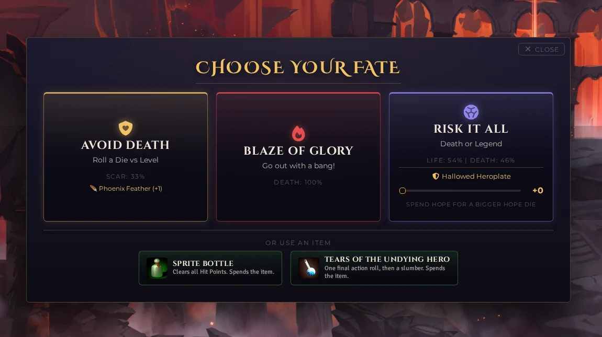
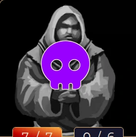
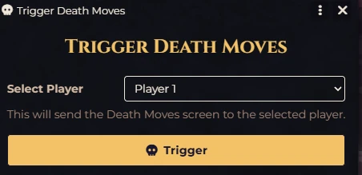
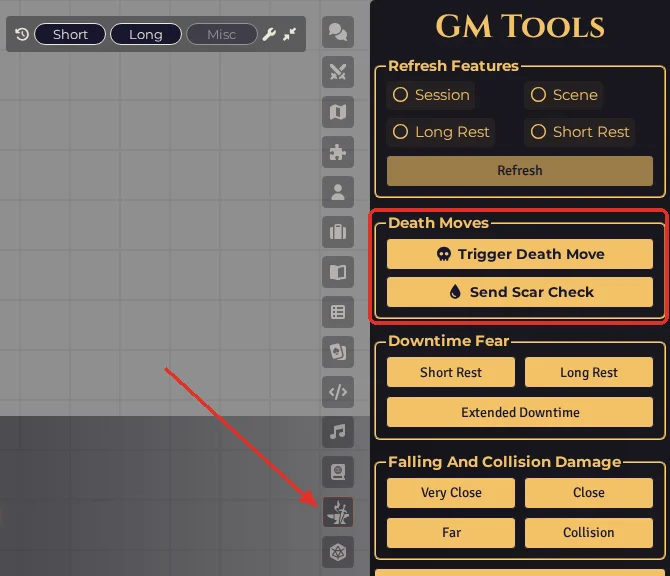
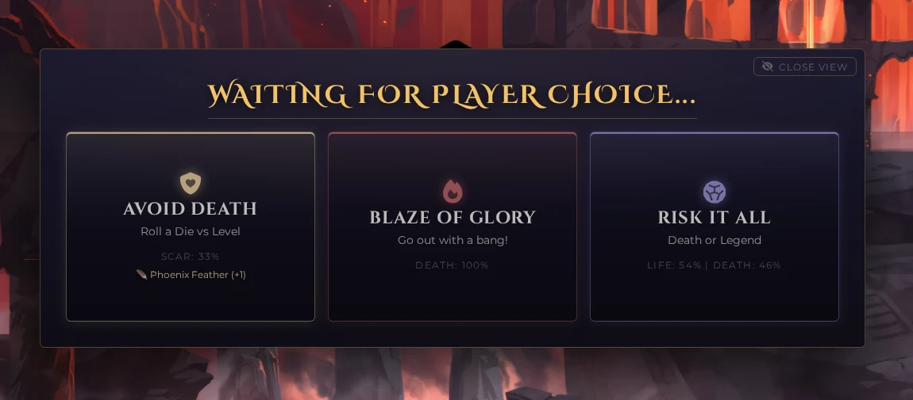
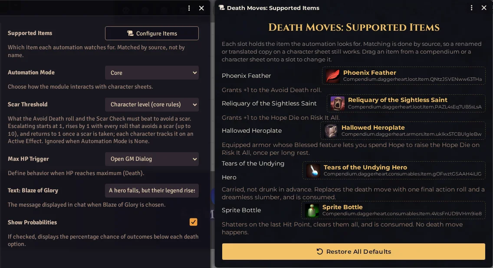

# ☠️ Daggerheart: Death Moves

When a character marks their last Hit Point in Daggerheart, the player has to choose a death move and roll for it, and then someone has to update the sheet: a scar, Hit Points and Stress cleared, or the end of the character.

Daggerheart: Death Moves does that whole sequence. When the last Hit Point is marked, the death move screen is sent to that player, or the GM is asked to confirm first. The player picks Avoid Death, Blaze of Glory or Risk It All while the rest of the table watches the same screen, the dice are rolled, and the result is written to the sheet. Two optional homebrew rules change how scars work: the player can choose which of six scars they take, and the chance of a scar can start at 1 in 12 and grow with every roll that avoids one.

<p align="center">
  
</p>


[](https://buymeacoffee.com/mestredigital) [](https://mestredigital.online/pages/projetos-en)

## What it does

### The death move screen

- The skull the character sheet puts over the portrait once every Hit Point is marked opens this module's screen instead of the system's own Death Move dialog. It is painted purple so you can tell it apart. The GM can press it, and so can the player the character belongs to. On the [Nice Sheets](https://github.com/brunocalado/dh-nice-sheets) character sheet, the **Take Death Move** banner at the top of the sidebar opens the same screen and keeps the sheet's own look.
- The dying player sees the three death moves side by side and picks one.
- Everyone else, GM included, sees the same screen in spectator mode while the player decides.
- Once the choice is made, a banner with the chosen move appears on every screen before the dice are rolled.
- Each move can show the odds of its outcome, worked out from the character's level and from the supported items they carry.
- When several characters fall at once, their death moves are queued and run one after the other.

### Rolls and automation

- Risk It All rolls the Fear die first, pauses, and then rolls the Hope die, with a colored border on every screen while each die is rolled.
- Every result is posted to chat as a card with the roll, the bonuses that applied and the outcome.
- With the Core automation, a failed Avoid Death roll adds a scar to the sheet, a Hope result on Risk It All lets the player split the Hope die between Hit Points and Stress, and a critical success clears all Hit Points and Stress.
- With the Homebrew automation, a scar opens a list of six scar types (Evasion, Hit Point, Hope, Negative Experience, Stress and Thresholds). The one the player picks is added to the sheet with its Active Effect already applied.
- With the escalating scar threshold, also a homebrew option, the Avoid Death roll is measured against a counter instead of the character's level. It is explained under [Escalating scar threshold](#escalating-scar-threshold).
- With Max HP Trigger set, marking the last Hit Point starts the death move on its own, or opens a confirmation dialog for the GM first.
- The GM can send the Avoid Death roll on its own as a Scar Check, without the character being on their last Hit Point.

### Supported items

- A Phoenix Feather adds 1 to the Avoid Death roll.
- A Reliquary of the Sightless Saint adds 1 to the Hope die on Risk It All.
- An equipped Hallowed Heroplate puts a Hope slider inside the Risk It All option, and the Hope spent there raises the Hope die. The armor has to be equipped, since an unworn armor grants none of its features. The once-per-long-rest limit uses the armor's own Blessed counter, so a Daggerheart long rest refreshes it. When the slider does not apply, the armor says why.
- Tears of the Undying Hero get their own button on the death move screen. One click skips the death move: the potion is consumed, the character takes one final action roll, and is left unconscious until an ally uses Tend to Wounds.
- A Sprite Bottle gets its own button on the death move screen. One click skips the death move: Hit Points are cleared, the bottle is consumed, and a chat card explains what happened.

## How to use it

### 1. Starting a death move

There are four ways in, and all of them lead to the same screen:

- On the character sheet, press the purple skull over the portrait, or the **Take Death Move** banner on a Nice Sheets sheet. It appears once every Hit Point is marked. A player pressing it asks the GM's client to run the scene, since that is where the queue and the chat cards live, so a GM has to be connected. A death move acts on the character assigned to the player, so the sheet has to be that character.
- In the Daggerheart Menu in the sidebar, click **Trigger Death Move** (skull icon) and select the player from the list.
- In a script macro, run `DeathMoves.trigger()`. You can use `DeathMoves.trigger("User Name")` to send it straight to one player.
- With **Max HP Trigger** configured, reaching maximum Hit Points starts the move on its own, or opens a confirmation dialog for the GM first.

<p align="center">
  
  &nbsp;&nbsp;
  
</p>

<p align="center">
  
</p>

### 2. The player chooses

The target player receives the screen with the three moves:

- Avoid Death rolls 1d12 against the character's level, or against the scar threshold when the escalating rule is on. A Phoenix Feather adds 1.
- Risk It All starts the sequential Fear and Hope roll with the border effects. With a Hallowed Heroplate equipped, a Hope slider sits inside the option.
- Blaze of Glory posts a farewell message to chat.

Any carried item that can replace the death move gets its own button below the three options, and one click uses it. Nothing is ever spent unless the player clicks it, so ignoring the buttons simply leads to the normal choice above.

### 3. The table watches

Everyone else is in spectator mode. They cannot interact, but they see the announcement banner in sync with the active player.

<p align="center">
  
</p>

### Sending a Scar Check

A Scar Check is the Avoid Death roll on its own, for when the story calls for a scar and the character still has Hit Points left.

1. In the Daggerheart Menu in the sidebar, click **Send Scar Check** and select the player. In a script macro, run `DeathMoves.scar()`, or `DeathMoves.scar("User Name")` to send it straight to one player.
2. The player sees a screen with a single option, the Scar Check, and clicks it to roll. The rest of the table watches, as in a death move.
3. The roll follows the same rules and automation as Avoid Death, Phoenix Feather included, and the chat card names it as a Scar Check.

The player can close the screen without rolling. The GM can send it again at any time.

### Escalating scar threshold

With **Scar Threshold** set to **Escalating counter (homebrew)**, the Avoid Death roll and the Scar Check are measured against a counter that each character keeps:

1. The threshold starts at 1, so only a 1 on the d12 gives a scar.
2. Every roll that avoids a scar raises the threshold by 1, up to 10. At 3, a roll of 1, 2 or 3 gives a scar.
3. Taking a scar sets the threshold back to 1. With the Homebrew automation, the scar counts only once the player picks it from the list, so closing the list without a choice leaves the threshold where it was.

The current value is on the sheet's Effects tab, as an Active Effect named "Scar Threshold" followed by the number. It changes nothing on the sheet, and its description explains the rule. Delete it to reset the threshold to 1. The setting is ignored when **Automation Mode** is **None**, because that mode does not write to the sheet.

## Configuration

Customize the module in **Configure Settings > Daggerheart: Death Moves**:

<p align="center">
  
</p>

| Setting | What it does |
| :--- | :--- |
| **Automation Mode** | **None** leaves the sheet alone. **Core** applies scars and Hit Points and Stress. **Homebrew** does the same, but asks the player which scar they take. |
| **Scar Threshold** | What the Avoid Death roll and the Scar Check are measured against: **Character level (core rules)** or **Escalating counter (homebrew)**. |
| **Max HP Trigger** | What happens when Hit Points reach maximum: **None (Manual)**, **Open GM Dialog** or **Trigger Automatically (Direct to Player)**. |
| **Supported Items** | Opens a window with one slot per automated item. Drag an item from a compendium or a character sheet onto a slot to change what the automation looks for. Matching is by source, not by name, so a renamed or translated copy still works. An item only carries a source if it reached the sheet from a compendium, directly or by way of the world Items directory. Homebrew created from scratch in the world Items directory carries none, so put it in a world compendium first and drag it from there. |
| **Text: Blaze of Glory** | The farewell message posted to chat. |
| **Show Probabilities** | Shows or hides the odds under each move. |

## Installation

Install it from the Foundry VTT module browser, or use this manifest link:

```
https://github.com/brunocalado/daggerheart-death-moves/releases/latest/download/module.json
```

The [latest release](https://github.com/brunocalado/daggerheart-death-moves/releases/latest) has the notes for each version and the zip.

It needs Foundry VTT v14, the Daggerheart system 2.10.11 or later, and the Dice So Nice module.

## ⚖️ Credits and License

* **Code License:** GPL-3.0.

**Disclaimer:** This module is an independent creation and is not affiliated with Darrington Press.

* **Artwork:** `thumbnail.webp` — [photo by Sebastian Arie Voortman](https://www.pexels.com/photo/woman-wearing-a-scary-costume-with-horns-18424789/), used under the [Pexels License](https://www.pexels.com/license/).

# 🧰 My Daggerheart Modules

| Module | Description |
| :--- | :--- |
| 💀 [**Adversary Manager**](https://github.com/brunocalado/daggerheart-advmanager) | Scale adversaries instantly and build balanced encounters. |
| 🖼️ [**Art Mapper**](https://github.com/brunocalado/dh-assets) | Automatically assigns artwork to system compendiums, actors, tokens, and custom module content — keeping your visuals organized and up to date. |
| 🐉 [**Colossus**](https://github.com/brunocalado/dh-colossus) | Manage massive multi-part boss encounters with independent HP per part and a single shared stress pool. |
| 📦 [**Containers**](https://github.com/brunocalado/dh-containers) | Group inventory items into collapsible containers — pouches, chests, backpacks — to declutter character sheets. |
| 💥 [**Critical**](https://github.com/brunocalado/daggerheart-critical) | Animated criticals. |
| 💠 [**Custom Stat Tracker**](https://github.com/brunocalado/dh-new-stat-tracker) | Add custom trackers to actors. |
| ☠️ [**Death Moves**](https://github.com/brunocalado/daggerheart-death-moves) | Enhances the Death Move moment with a dramatic interface and full automation. |
| 📏 [**Distances**](https://github.com/brunocalado/daggerheart-distances) | Visualizes combat ranges with customizable rings and hover calculations. |
| 📦 [**Extra Content**](https://github.com/brunocalado/daggerheart-extra-content) | Homebrew content pack. |
| 😱 [**Fear Tracker**](https://github.com/brunocalado/daggerheart-fear-tracker) | Adds an animated slider bar with configurable fear tokens to the UI. |
| 🧟 [**Horde**](https://github.com/brunocalado/dh-horde) | Explode single horde tokens into dozens of individual tokens and manage their movement and stats automatically. |
| 🎁 [**Mystery Box**](https://github.com/brunocalado/dh-mystery-box) | Introduces mystery box mechanics for random loot and surprises. |
| 📝 [**Nice Sheets**](https://github.com/brunocalado/dh-nice-sheets) | An alternative character sheet with a resource sidebar, ranked trait plaques, and the character's art filling the background. |
| ⚡ [**Quick Actions**](https://github.com/brunocalado/daggerheart-quickactions) | Quick access to common mechanics like Falling Damage, Downtime, etc. |
| 📜 [**Quick Rules**](https://github.com/brunocalado/daggerheart-quickrules) | Fast and accessible reference guide for the core rules. |
| 🤖 [**Resource Macros**](https://github.com/brunocalado/daggerheart-fear-macros) | Automatically executes macros when the Fear, Hope, Stress, HP, or Armor resources change. |
| 🎲 [**Stats**](https://github.com/brunocalado/daggerheart-stats) | Tracks dice rolls from GM and Players. |
| 🧠 [**Stats Toolbox**](https://github.com/brunocalado/dh-statblock-importer) | Import actors using a statblock. |
| 🛒 [**Store**](https://github.com/brunocalado/daggerheart-store) | A dynamic, interactive, and fully configurable in-game store. |
| 🔍 [**Unidentified**](https://github.com/brunocalado/dh-unidentified) | Obfuscates item names and descriptions until they are identified by the players. |
| 🌌 [**Void**](https://github.com/brunocalado/the-void-unofficial) | Unofficial module that brings The Void playtesting content — experimental classes, subclasses, ancestries, communities, adversaries, loot, weapons, and more. |

# 🗺️ Adventures

| Adventure | Description |
| :--- | :--- |
| ✨ [**I Wish**](https://github.com/brunocalado/i-wish-daggerheart-adventure) | A wealthy merchant is cursed; one final expedition may be the only hope. |
| 💣 [**Suicide Squad**](https://github.com/brunocalado/suicide-squad-daggerheart-adventure) | Criminals forced to serve a ruthless master in a land on the brink of war. |
